<h1 align="center">git-cv</h1>

<p align="center">
  <strong>GitHub Pages + Supabase 로 만드는 개발자 이력서 · 포트폴리오 사이트</strong><br/>
  서버 비용 0원. 어드민 화면에서 내용을 고치면 방문자에게는 즉시, 검색엔진에는 다음 빌드에서 반영됩니다.
</p>

<p align="center">
  <a href="#-빠른-시작"></a>
  <a href="#-무료-티어-기준"></a>
  <a href="#-lighthouse"></a>
  <a href="#-라이선스"></a>
</p>

<p align="center">
  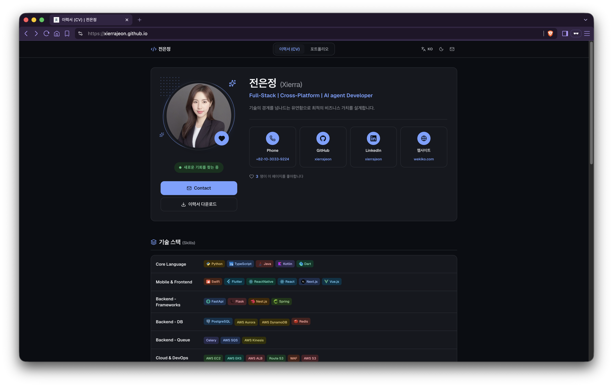
</p>

<p align="center">
  <a href="https://xierrajeon.github.io">라이브 데모</a> ·
  <a href="#-빠른-시작">빠른 시작</a> ·
  <a href="docs/SETUP.md">개발자용 셋업</a> ·
  <a href="#-자주-겪는-문제">FAQ</a>
</p>

---

## ✨ 주요 특징

- **🚀 서버리스** — GitHub Pages 정적 호스팅 + Supabase 무료 티어. 유지비 0원.
- **✍️ 어드민 UI 내장** — `/admin` 에서 이력서·포트폴리오·프로젝트 상세를 즉시 편집.
- **🔍 SEO 친화** — 빌드 시점에 데이터를 읽어 정적 HTML 을 굽고, 방문자에겐 최신 데이터로 다시 맞춤.
- **⚡ Lighthouse 100** — 이미지는 브라우저에서 WebP 로 축소, YouTube 는 클릭 후 로드.
- **🔒 RLS 로 방어** — 익명 키로는 `is_published = true` 만 읽히고, 쓰기는 `admins` 이메일로 로그인해야만 허용.

## 📚 목차

- [빠른 시작](#-빠른-시작)
  - [1. GitHub 계정 만들기](#1-github-계정-만들기)
  - [2. 리포지토리 Fork & 이름 바꾸기](#2-리포지토리-fork--이름-바꾸기)
  - [3. Supabase 프로젝트 만들기](#3-supabase-프로젝트-만들기)
  - [4. Supabase 스키마 적용](#4-supabase-스키마-적용)
  - [5. 관리자 계정 만들기](#5-관리자-계정-만들기)
  - [6. GitHub Actions 시크릿 등록](#6-github-actions-시크릿-등록)
  - [7. GitHub Pages 활성화](#7-github-pages-활성화)
  - [8. 어드민 로그인 & 첫 내용 채우기](#8-어드민-로그인--첫-내용-채우기)
- [로컬 개발](#-로컬-개발-선택)
- [어드민 재배포 버튼](#-어드민-재배포-버튼-선택)
- [프로젝트 구조](#-프로젝트-구조)
- [설계 배경](#-설계-배경)
- [자주 겪는 문제](#-자주-겪는-문제)
- [무료 티어 기준](#-무료-티어-기준)
- [Lighthouse](#-lighthouse)
- [라이선스](#-라이선스)

---

## 🚀 빠른 시작

> **누구를 위한 문서인가요?**
> "깃허브도 처음이고, 서버도 없고, 그냥 내 이력서 사이트 하나 만들어보고 싶다" 는 분을 위한 문서입니다.
> 아래 순서대로 따라오시면 **약 1시간 안에** 본인 도메인(무료)에서 굴러가는 이력서 사이트가 완성됩니다.
> 개발 경험이 있으시면 [`docs/SETUP.md`](docs/SETUP.md) 만 봐도 충분합니다.

**준비물**

- 이메일 계정 하나
- 컴퓨터 (macOS / Windows / Linux)
- 약 1시간

**들어가는 돈**: **0원** — GitHub 무료 티어 · Supabase 무료 티어로만 동작하도록 설계.

### 전체 순서

| #   | 단계                          | 하는 곳             |
| --- | ----------------------------- | ------------------- |
| 1   | GitHub 계정 만들기            | github.com          |
| 2   | 리포지토리 Fork & 이름 바꾸기 | github.com          |
| 3   | Supabase 프로젝트 만들기      | supabase.com        |
| 4   | Supabase 스키마 적용          | Supabase SQL Editor |
| 5   | 관리자 계정 만들기            | Supabase Auth       |
| 6   | GitHub Actions 시크릿 등록    | GitHub Settings     |
| 7   | GitHub Pages 활성화           | GitHub Settings     |
| 8   | 어드민 로그인 & 내용 채우기   | 배포된 사이트       |

---

### 1. GitHub 계정 만들기

> 이미 계정이 있으면 **[2단계](#2-리포지토리-fork--이름-바꾸기)로** 건너뛰세요.

1. https://github.com/signup 접속
2. 이메일 → 비밀번호 → **Username** 입력

> [!IMPORTANT]
> **Username 이 곧 사이트 주소가 됩니다.**
> 예를 들어 `hongildong` 으로 지으면 최종 주소는 `https://hongildong.github.io` 이 됩니다.
> 나중에 바꾸기 번거로우니 신중하게. 영문 소문자 · 숫자 · 하이픈만 가능합니다.

3. 이메일 인증 코드 입력 → 가입 완료
4. 우측 상단 아바타 → **Your profile** 클릭해 계정이 살아있는지 확인

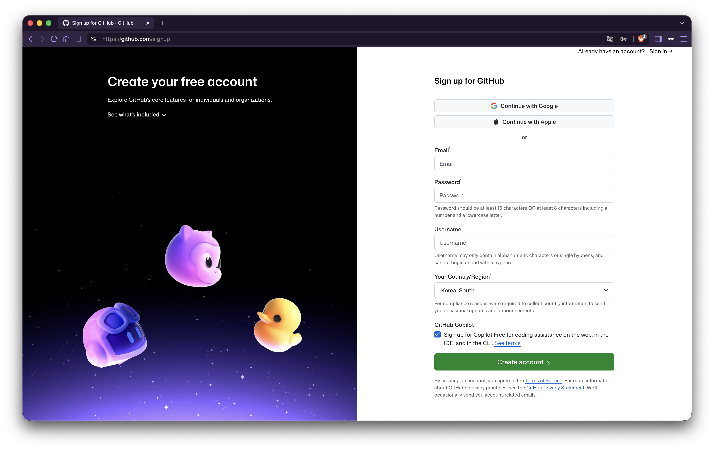

---

### 2. 리포지토리 Fork & 이름 바꾸기

**Fork** = 남의 저장소를 내 계정으로 그대로 복제하는 것. 원본은 건드리지 않습니다.

1. 이 리포지토리 페이지 접속 (원본: https://github.com/xierrajeon/xierrajeon.github.io)
2. 우측 상단 **Fork** 버튼 클릭

   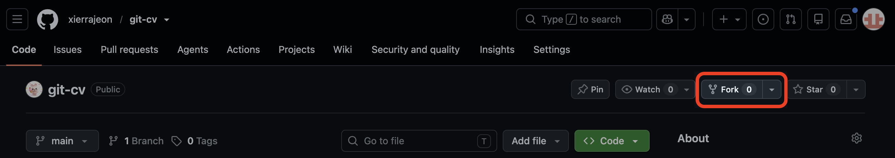

3. Fork 생성 폼에서:
   - **Owner** — 본인 계정
   - **Repository name** — **`<본인아이디>.github.io`** 로 반드시 변경 (예: `hongildong.github.io`)
   - **"Copy the `main` branch only"** — 체크된 상태 유지
4. **Create fork** 클릭 → 잠시 뒤 내 계정 아래에 리포지토리가 생성됨

   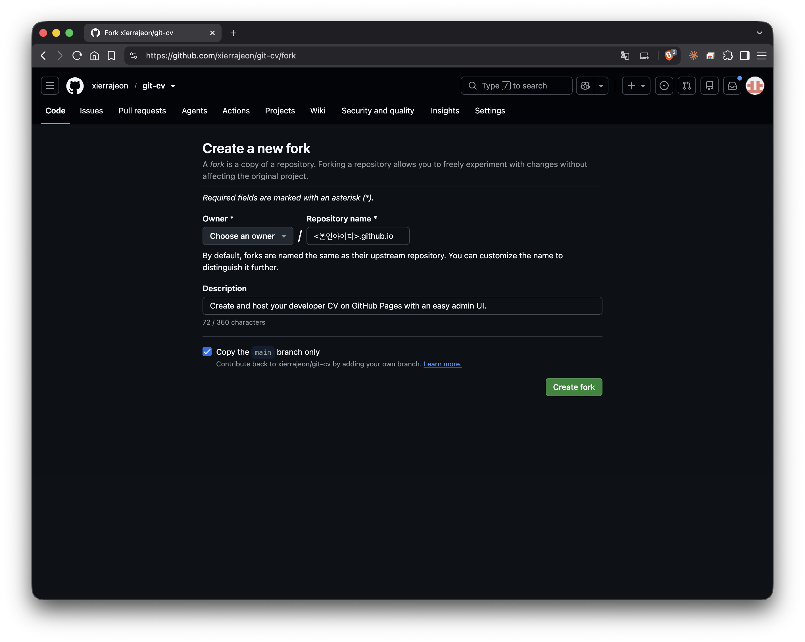

> [!NOTE]
> **왜 이름이 `<본인아이디>.github.io` 여야 하나요?**
> GitHub Pages 규칙입니다. 이 이름을 쓰면 `https://<본인아이디>.github.io` 라는 무료 주소를 그대로 얻습니다.

---

### 3. Supabase 프로젝트 만들기

Supabase 는 이 프로젝트의 데이터베이스 역할을 합니다. 무료 플랜 안에서 동작합니다.

#### 3-1. 가입 · 로그인

1. https://supabase.com/dashboard 접속
2. **Sign in with GitHub** 클릭 → 방금 만든 GitHub 계정으로 로그인
3. 권한 요청 창에서 **Authorize Supabase**

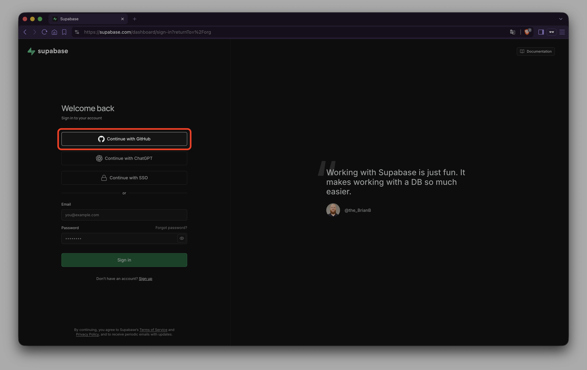

#### 3-2. 조직(Organization) 만들기

로그인 직후 조직 생성 화면이 나옵니다.

- **Name** — 아무 이름 (예: `my-cv`)
- **Type** — `Personal`
- **Plan** — `Free`
- **Create organization**

#### 3-3. 프로젝트 생성

1. **New project** 클릭
2. 입력:
   - **Name** — `cv` 등 아무 이름
   - **Database Password** — **꼭 어딘가에 적어두세요.**
   - **Region** — 가장 가까운 곳 (한국이면 `Northeast Asia (Seoul)` 또는 `Tokyo`)
   - **Plan** — `Free`
3. **Create new project** → 프로비저닝 1~2분

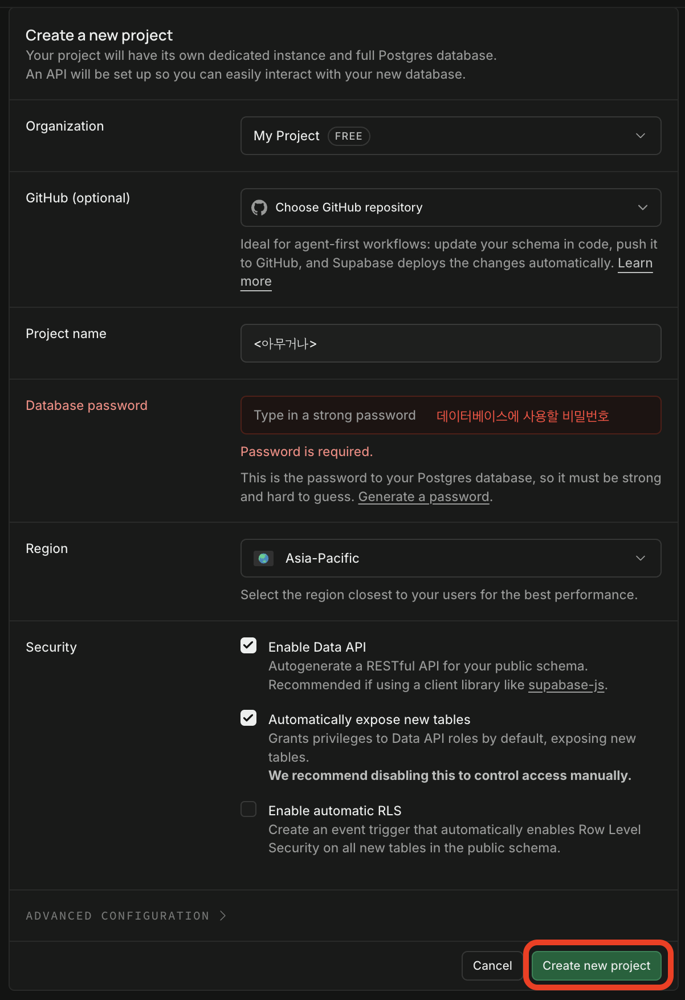

#### 3-4. URL · anon key 확인 (뒤에서 씁니다)

좌측 사이드바에서:

- **Project Settings → Data API** → `Project URL` 값 (`https://xxxxxxxxxxxx.supabase.co`)

  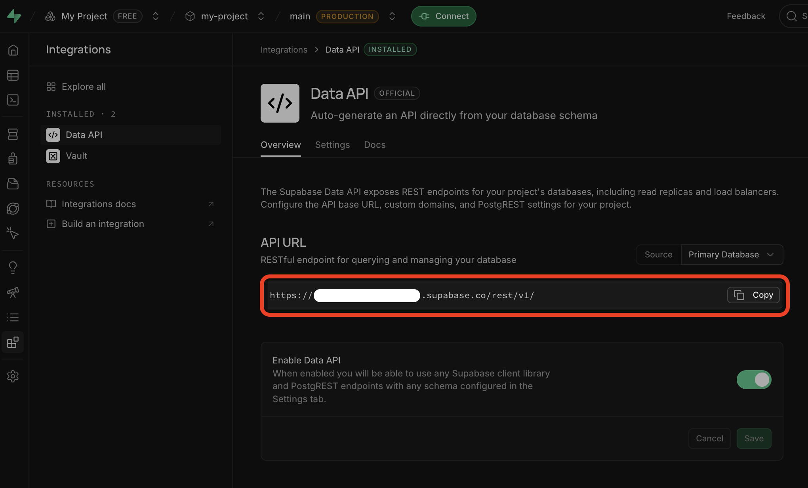

- **Project Settings → API Keys** → `anon public` 키 (`eyJhbGciOi...` 로 시작)

  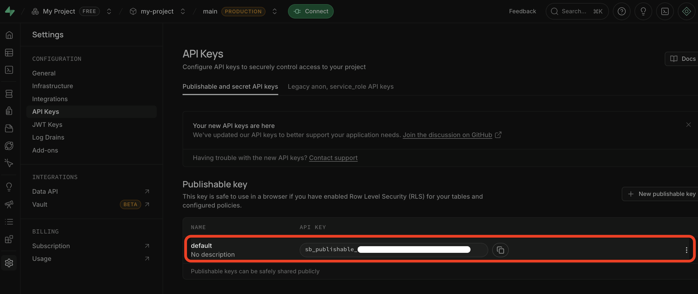

두 값을 메모장에 복사해 두세요. **6단계** 에서 사용합니다.

> [!CAUTION]
> **`service_role` 키는 이 프로젝트에서 절대 쓰지 않습니다.**
> 이 키가 유출되면 DB 전체가 뚫립니다. 복사하지도 마세요.

---

### 4. Supabase 스키마 적용

이 프로젝트가 쓰는 테이블과 권한 규칙을 한 번에 생성합니다.

1. 좌측 사이드바 → **SQL Editor**
2. 상단 **New query**
3. 내 리포지토리에서 [`supabase/schema.sql`](supabase/schema.sql) 을 열어 **전체 내용 복사**
   - GitHub 파일 우측 상단 **Copy raw file** 아이콘이 편합니다.
4. SQL Editor 에 붙여넣고 우측 하단 **Run** (또는 `Cmd/Ctrl + Enter`)
5. `Success. No rows returned` 메시지 확인

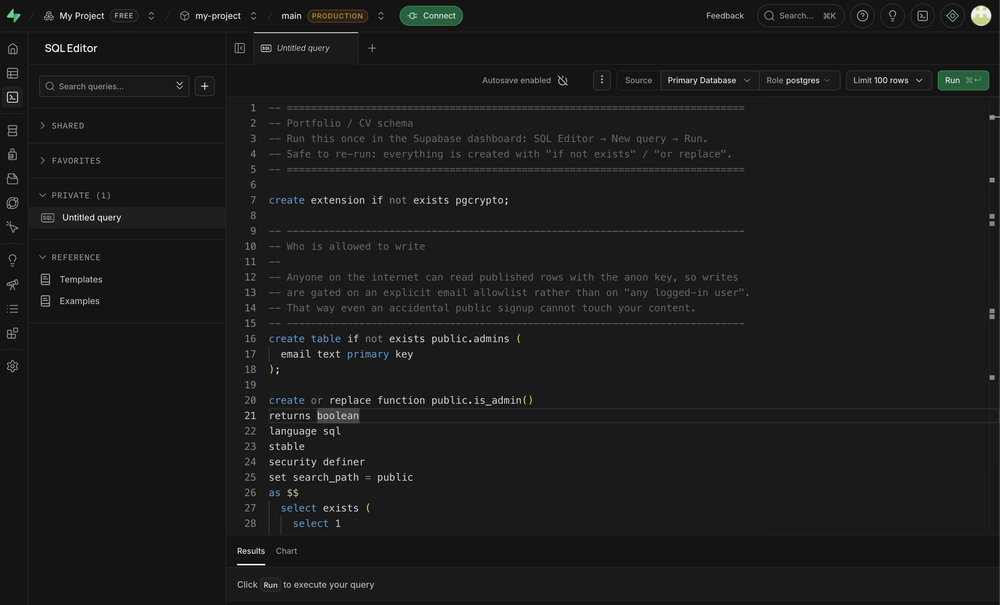

---

### 5. 관리자 계정 만들기

`/admin` 페이지에 로그인할 계정을 하나 만듭니다. 이 계정만이 사이트 내용을 수정할 수 있습니다.

#### 5-1. 관리자 이메일을 DB 에 등록

**SQL Editor → New query** 에서 아래를 붙여넣고 이메일만 바꿔서 **Run**:

```sql
insert into public.admins (email) values ('your-login@example.com')
on conflict (email) do nothing;
```

> [!WARNING]
> 이 이메일은 **리포지토리에 커밋하지 마세요.** SQL Editor 에서만 직접 실행합니다.

#### 5-2. 공개 회원가입 차단

관리자 외에는 아무도 계정을 만들지 못하도록 잠급니다.

1. 좌측 사이드바 → **Authentication → Sign In / Providers**
2. **Email** 항목 클릭
3. `Confirm email` — **켜둔 채로 유지**
4. **Allow new users to sign up** — **OFF**
5. **Save**

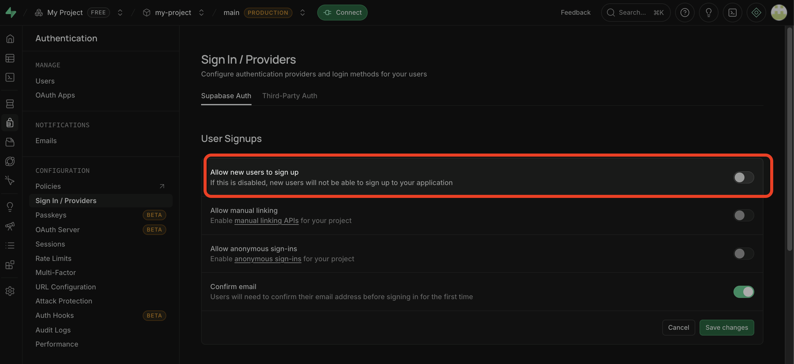

#### 5-3. 관리자 계정 생성

1. 좌측 사이드바 → **Authentication → Users**
2. **Add user → Create new user**
3. 입력:
   - **Email** — 5-1 에서 `admins` 테이블에 넣은 이메일과 **정확히 동일**
   - **Password** — 원하는 비밀번호 (기록해두기)
   - **Auto Confirm User** — 반드시 **체크** (안 하면 로그인 불가)
4. **Create user**

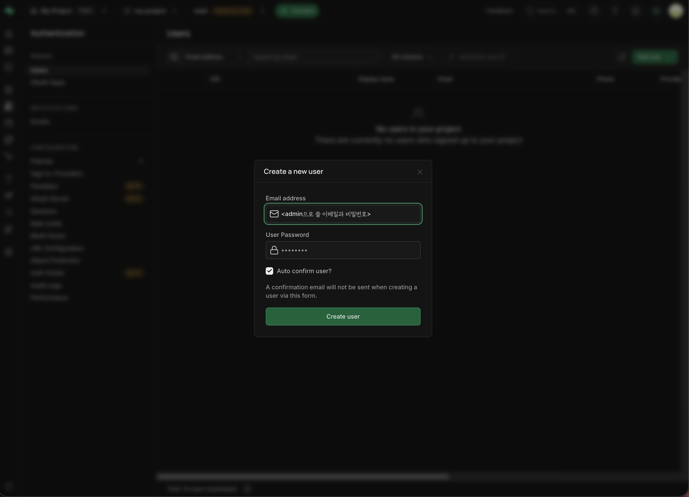

---

### 6. GitHub Actions 시크릿 등록

빌드할 때 Supabase 에서 데이터를 읽어 HTML 을 만들어야 하니, GitHub 에게 Supabase 접속 정보를 알려줍니다.

1. 내 리포지토리 페이지 (`https://github.com/<본인아이디>/<본인아이디>.github.io`)
2. 상단 **Settings** 탭
3. 좌측 **Secrets and variables → Actions**
4. **New repository secret** 으로 **두 개** 등록:

| Name (그대로)                   | Value                   |
| ------------------------------- | ----------------------- |
| `NEXT_PUBLIC_SUPABASE_URL`      | 3-4 의 `Project URL`    |
| `NEXT_PUBLIC_SUPABASE_ANON_KEY` | 3-4 의 `anon public` 키 |

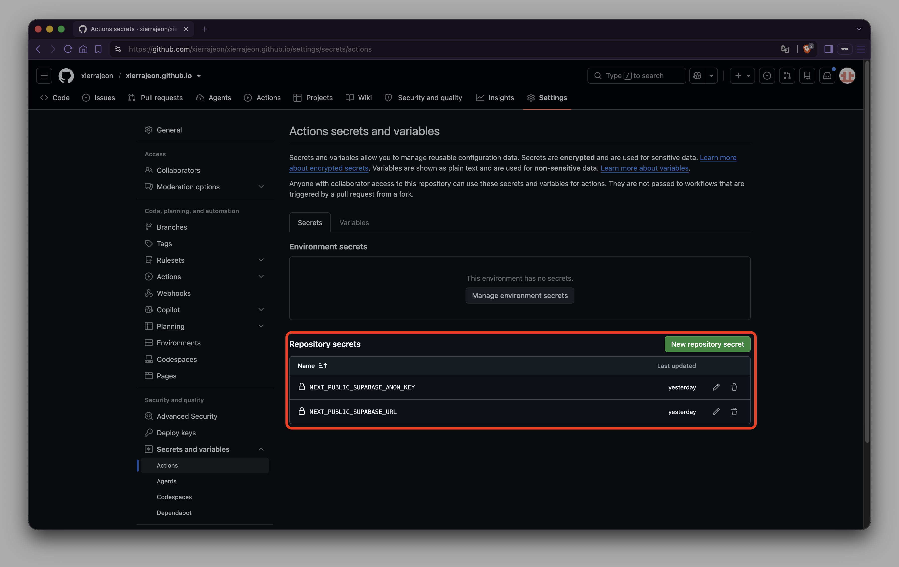

---

### 7. GitHub Pages 활성화

1. 여전히 리포지토리 **Settings**
2. 좌측 **Pages**
3. **Build and deployment → Source** 를 **`GitHub Actions`** 로 변경
   > `Deploy from a branch` 가 아니라 반드시 `GitHub Actions` 입니다.
4. 저장 버튼은 없습니다. 선택하는 순간 반영됨.

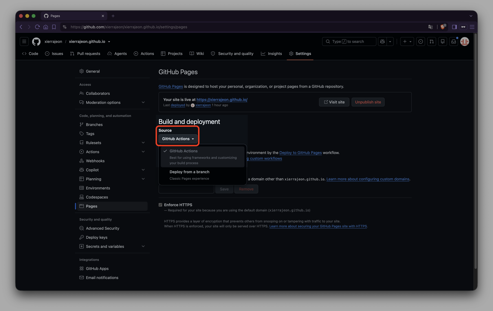

#### 첫 배포 실행

- **방법 A (추천)** — 상단 **Actions** 탭 → 좌측 `Deploy to GitHub Pages` → 우측 **Run workflow** → 초록 **Run workflow** 버튼

- **방법 B** — 아무 파일이나 조금 수정해 커밋 (예: 이 README 의 한 글자)

Actions 탭에서 초록 체크가 뜨면 배포 성공. 2~5분 소요.

🎉 이제 `https://<본인아이디>.github.io` 로 접속하면 사이트가 뜹니다.

---

### 8. 어드민 로그인 & 첫 내용 채우기

1. `https://<본인아이디>.github.io/admin` 접속

   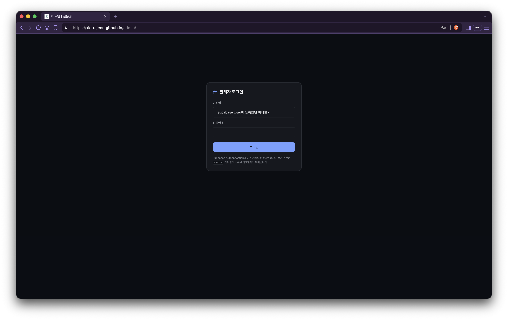

2. 5단계에서 만든 이메일 / 비밀번호로 로그인

   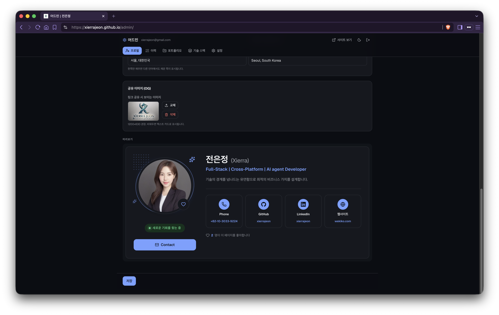

3. 프로필 · 이력서 · 포트폴리오 · 프로젝트 상세를 좌측 메뉴에서 순서대로 채우기
4. **저장하면 방문자에게는 즉시 반영됩니다.**
5. 검색엔진(구글 등)에 노출되는 HTML 은 다음 자동 배포 때 갱신됩니다. 급하면 아래 [재배포 버튼](#-어드민-재배포-버튼-선택) 설정 또는 Actions 탭에서 수동 재실행.

---

## 💻 로컬 개발 (선택)

배포 전에 내 컴퓨터에서 미리 확인하고 싶을 때.

**준비**

- [Node.js](https://nodejs.org) **22 이상**
- [Git](https://git-scm.com/downloads)

**실행**

```bash
git clone https://github.com/<본인아이디>/<본인아이디>.github.io.git
cd <본인아이디>.github.io
npm install
cp .env.example .env.local     # Windows PowerShell: copy .env.example .env.local
```

`.env.local` 을 열어 3-4 에서 복사해둔 값으로 채웁니다:

```dotenv
NEXT_PUBLIC_SUPABASE_URL=https://xxxxxxxxxxxx.supabase.co
NEXT_PUBLIC_SUPABASE_ANON_KEY=eyJhbGciOi...
NEXT_PUBLIC_SITE_URL=https://<본인아이디>.github.io
```

> `.env.local` 은 `.gitignore` 에 등록되어 있어 실수로 커밋되지 않습니다.

```bash
npm run dev
```

- 공개 사이트: http://localhost:3000
- 어드민: http://localhost:3000/admin

배포될 정적 파일 확인:

```bash
npm run build       # out/ 폴더에 결과 생성
```

---

## 🔄 어드민 재배포 버튼 (선택)

어드민에서 내용을 저장하면 방문자에게는 즉시 보이지만, **검색엔진 크롤러가 보는 정적 HTML 은 다음 빌드 때 갱신됩니다.**
자동으로 재빌드를 트리거하려면 GitHub 토큰을 발급해 어드민에 등록합니다.

1. GitHub → 우측 상단 아바타 → **Settings**
2. 좌측 하단 **Developer settings**
3. **Personal access tokens → Fine-grained tokens → Generate new token**
4. 입력:
   - **Token name** — 예: `cv-admin-redeploy`
   - **Expiration** — 원하는 만료일 (예: 1년)
   - **Repository access** — **Only select repositories** → `<본인아이디>.github.io` 만 선택
   - **Permissions → Repository permissions → Contents** → **Read and write**
5. **Generate token** → 화면에 딱 한 번 보이는 값 복사

   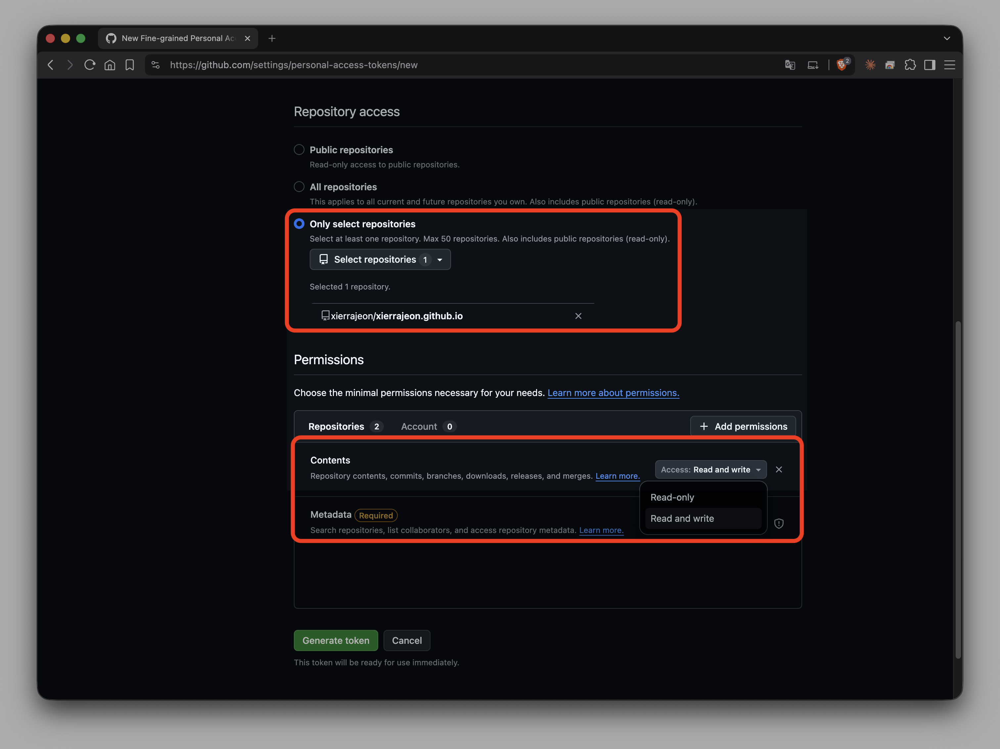

6. `/admin` → 설정 화면 → 토큰 입력 칸에 붙여넣기 → 저장

> [!NOTE]
> 토큰은 브라우저 `localStorage` 에만 저장되며 DB 나 리포지토리에는 저장되지 않습니다.
> 브라우저를 바꾸거나 캐시를 지우면 다시 입력해야 합니다.

---

## 🗂 프로젝트 구조

```
src/
├── app/
│   ├── (site)/          공개 페이지 — 이력서 탭 / 포트폴리오 탭 / 프로젝트 상세
│   ├── admin/           어드민 (클라이언트 전용, RLS 로 보호)
│   └── not-found.tsx    404.html — 아직 빌드되지 않은 프로젝트를 즉시 렌더
├── components/          UI. 공개 컴포넌트를 어드민 미리보기에서 그대로 재사용
└── lib/                 타입 · 쿼리 · i18n · 업로드

supabase/
└── schema.sql           테이블 · RLS · 스토리지 (SQL Editor 에 붙여넣기)

.github/workflows/
└── deploy.yml           main push · repository_dispatch · 수동 실행 시 배포
```

---

## 🧠 설계 배경

<details>
<summary><strong>GitHub Pages 는 서버가 없다</strong></summary>

SEO 와 "저장하면 즉시 반영" 이 정면으로 충돌합니다.
빌드 시점에 Supabase 에서 데이터를 읽어 HTML 을 굽고(크롤러가 보는 것),
방문자 브라우저에서 최신 데이터로 다시 맞춥니다(사람이 보는 것).
새로 만든 프로젝트는 정적 파일이 아직 없으므로 `404.html` 이 슬러그를 읽어
클라이언트에서 렌더하고, 어드민의 재배포 버튼이 정적 파일을 따라오게 합니다.

</details>

<details>
<summary><strong>publishable 키는 번들에 들어간다</strong></summary>

브라우저가 Supabase 에 직접 요청하니 숨길 수 없고, 숨길 필요도 없습니다.
실제 방어선은 RLS 입니다 — 익명 키로는 `is_published = true` 행만 읽히고,
쓰기는 `admins` 테이블에 등록된 이메일로 로그인해야 합니다.
`service_role` 키는 이 프로젝트에서 쓰지 않습니다.

</details>

<details>
<summary><strong>이미지는 업로드 전에 브라우저에서 줄인다</strong></summary>

Supabase 이미지 변환은 유료 기능이라, 어드민이 canvas 로 WebP 변환·축소한 뒤 올립니다.
원본 크기를 함께 저장해 공개 페이지가 로딩 전에 자리를 잡습니다 (CLS 0).

</details>

<details>
<summary><strong>유튜브 iframe 은 클릭 후에 붙인다</strong></summary>

보기도 전에 1MB 스크립트를 받는 게 성능 점수를 깎는 가장 쉬운 방법이라, 포스터만 먼저 보여줍니다.

</details>

---

## ❓ 자주 겪는 문제

<details>
<summary>사이트 주소로 들어가면 404 가 뜹니다.</summary>

- 리포지토리 이름이 정확히 `<본인아이디>.github.io` 인지 확인 (대소문자 포함).
- **Settings → Pages** 에서 Source 가 `GitHub Actions` 인지 확인.
- **Actions** 탭에서 최근 워크플로우가 초록색으로 성공했는지 확인. 실패 시 로그로 원인 파악.
</details>

<details>
<summary>Actions 로그에 <code>NEXT_PUBLIC_SUPABASE_URL is required</code> 에러.</summary>

6단계 시크릿 이름을 오타 없이 정확히 입력했는지 확인. 앞뒤 공백이 붙는 경우가 흔합니다.

</details>

<details>
<summary><code>/admin</code> 에서 로그인이 안 됩니다.</summary>

- 5-1 의 SQL 이 실행됐는지, 그때 넣은 이메일과 5-3 에서 만든 계정 이메일이 **정확히 같은지** 확인.
- 5-3 에서 `Auto Confirm User` 를 체크했는지 확인.
</details>

<details>
<summary>어드민에서 저장한 내용이 사이트에 안 보입니다.</summary>

- 방문자용 클라이언트 화면에는 즉시 보입니다. 안 보이면 브라우저 새로고침 (`Cmd/Ctrl + Shift + R`).
- 정적 HTML(검색엔진에 보이는 것)은 재배포되어야 갱신됩니다. Actions 탭에서 수동 재실행하거나 재배포 버튼 사용.
</details>

<details>
<summary>Supabase 무료 티어가 정지됐다고 나옵니다.</summary>

무료 프로젝트는 약 1주간 요청이 없으면 자동 일시정지됩니다. 대시보드에서 **Restore project** 로 즉시 복구. 방문자가 있으면 발생하지 않습니다.

</details>

---

## 💰 무료 티어 기준

- Supabase Storage 1GB / 월 egress 5GB. **긴 영상은 유튜브에 올리고 링크만 붙이세요.**
  어드민 영상 블록이 유튜브·Vimeo URL 을 지원합니다. 직접 업로드는 짧은 기능 시연 클립(수 MB) 용도로만 권장.
- 이미지는 어드민 업로드 시 브라우저에서 자동으로 리사이즈·WebP 변환됩니다.
- 무료 Supabase 프로젝트는 일정 기간 요청이 없으면 일시정지됩니다. 방문자가 있으면 문제되지 않음.

---

## 📊 Lighthouse

Desktop, 정적 빌드 기준.

| 페이지             | Performance | Accessibility | Best Practices |   SEO   |
| ------------------ | :---------: | :-----------: | :------------: | :-----: |
| `/`                |   **100**   |    **100**    |       96       | **100** |
| `/portfolio`       |     99      |    **100**    |       96       | **100** |
| `/projects/[slug]` |   **100**   |    **100**    |       96       | **100** |

Best Practices 96 은 Supabase 테이블이 아직 없어 발생한 콘솔 404 때문이며, `supabase/schema.sql` 을 적용하면 사라집니다.

---

## 📄 라이선스

[MIT](LICENSE). 자유롭게 포크해서 본인 이력서로 쓰세요.

---

<p align="center">
  <sub>스크린샷을 채우고 싶다면 <a href="docs/images/README.md">docs/images/README.md</a> 의 shot list 참고.</sub>
</p>
